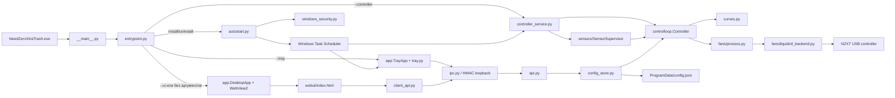

# Карта проекта NeedZeroXtraTrash

Актуально для версии **4.6**. Это навигатор по исходникам, процессам и основным
маршрутам данных. Пользовательская инструкция и команды находятся в
[README.md](README.md); требования исправлений v3.0 сохранены в
[CODEX_FIX_TASK.md](CODEX_FIX_TASK.md).

## Быстрый поиск места изменения

| Что требуется изменить | Основные файлы | Минимальная проверка |
|---|---|---|
| Внешний вид, размеры, вкладки, график | [webui/index.html](src/needzero/webui/index.html), [webui/assets](src/needzero/webui/assets/) | `node tests\ui_behavior_smoke.js` |
| Добавление/удаление точек кривой | [webui/index.html](src/needzero/webui/index.html), [config.py](src/needzero/config.py), [api.py](src/needzero/api.py) | `pytest tests/test_core.py tests/test_ui_behavior.py -q` |
| Расчёт duty по температуре | [curves.py](src/needzero/curves.py), [controlloop.py](src/needzero/controlloop.py) | `pytest tests/test_core.py tests/test_safety.py -q` |
| Порог emergency или fail-safe | [config.py](src/needzero/config.py), [curves.py](src/needzero/curves.py), [controlloop.py](src/needzero/controlloop.py) | `pytest tests/test_safety.py -q` |
| Новый источник температуры | [sensors](src/needzero/sensors/), [config.py](src/needzero/config.py) | `pytest tests/test_core.py tests/test_sensors_supervisor.py -q` |
| Работа с NZXT и RPM | [fans](src/needzero/fans/), [controlloop.py](src/needzero/controlloop.py) | `pytest tests/test_core.py tests/test_safety.py -q` |
| IPC-метод между UI и controller | [client_api.py](src/needzero/client_api.py), [ipc.py](src/needzero/ipc.py), [api.py](src/needzero/api.py) | `pytest tests/test_ipc.py -q` |
| Сохранение настроек | [config.py](src/needzero/config.py), [config_store.py](src/needzero/config_store.py), [api.py](src/needzero/api.py) | `pytest tests/test_config_transactions.py -q` |
| Трей, закрытие или сворачивание | [app.py](src/needzero/app.py), [tray.py](src/needzero/tray.py), [client_api.py](src/needzero/client_api.py) | `pytest tests/test_process_separation.py -q` |
| Автозапуск, обновление, UAC | [autostart.py](src/needzero/autostart.py), [windows_security.py](src/needzero/windows_security.py), [runtime_paths.py](src/needzero/runtime_paths.py) | `pytest tests/test_security_autostart.py -q` |
| Состав или размер EXE | [NeedZeroXtraTrash.spec](NeedZeroXtraTrash.spec), [build_release.py](build_release.py), lock-файлы | `pytest tests/test_build_release.py -q` |
| Версия и имя новой сборки | [version.txt](version.txt), fallback в [needzero/__init__.py](src/needzero/__init__.py), README | полный `pytest`, затем RELEASE build |

## Архитектура в одном экране

Главное архитектурное правило: только процесс **Controller** имеет право писать
в USB-контроллер. UI и Tray являются заменяемыми клиентами и не владеют
охлаждением.

## Процессы и точки входа

| Процесс/режим | Точка входа | Владелец | Назначение |
|---|---|---|---|
| `--controller` | `entrypoint.main()` → `run_controller()` | LocalSystem в RELEASE | Датчики, расчёт кривых, USB, IPC, защищённая конфигурация |
| `--tray` | `entrypoint.main()` → `run_tray()` | текущий пользователь | Лёгкое меню, профили, 100%, автозапуск, открытие UI |
| `--ui` | `entrypoint.main()` → `run_ui()` | текущий пользователь | Отдельное окно WebView2 |
| без аргументов | как `--ui` | текущий пользователь | Обычный ручной запуск EXE |
| `--startup` | `run_startup()` | текущий пользователь, DEV | DEV bootstrap controller, затем Tray |
| `--install-autostart` | `autostart.install_elevated()` | повышенный процесс | Защищённая установка RELEASE и две задачи |
| `--uninstall-autostart` | `autostart.uninstall_elevated()` | повышенный процесс | Безопасная остановка, удаление задач и бинарника |

[needzero/__main__.py](src/needzero/__main__.py) сначала вызывает
`multiprocessing.freeze_support()`, чтобы дочерний USB-процесс PyInstaller не
запустил приложение повторно. [entrypoint.py](src/needzero/entrypoint.py)
разделяет import-графы Controller, Tray и WebView2.

## Основные маршруты работы

### 1. Первый запуск подписанного RELEASE

1. `run_ui()` получает mutex UI в [single_instance.py](src/needzero/single_instance.py).
2. `_bootstrap_first_run_controller()` проверяет защищённый IPC.
3. Если установка отсутствует, [autostart.py](src/needzero/autostart.py) запускает
   этот же EXE с `--install-autostart` через UAC.
4. Установщик проверяет подпись и копирует EXE в Program Files.
5. Создаются Controller task под LocalSystem и UI/Tray task для SID пользователя.
6. Создаются защищённые token, manifest и config в ProgramData.
7. Controller task запускается и обязан подтвердить готовность через новый token.
8. Пользовательский процесс запускает Tray, затем открывает WebView2.

### 2. Обычный цикл охлаждения

1. [controller_service.py](src/needzero/controller_service.py) загружает token и
   конфигурацию.
2. [sensors/__init__.py](src/needzero/sensors/__init__.py) создаёт supervisor и
   подключает необходимые sensor backend’ы.
3. [controlloop.py](src/needzero/controlloop.py) получает свежие показания и
   преобразует их в `Temps`.
4. [curves.py](src/needzero/curves.py) интерполирует кривые и рассчитывает duty
   групп Front/Top/Rear с учётом minimum duty, sensor fault и emergency.
5. [fans/process.py](src/needzero/fans/process.py) передаёт ограниченную команду
   отдельному процессу-владельцу liquidctl.
6. [fans/liquidctl_backend.py](src/needzero/fans/liquidctl_backend.py) пишет duty
   в `fan1..fan3` и читает фактические duty/RPM.
7. Control loop подтверждает результат, обновляет fault-состояния и snapshot.
8. UI получает snapshot методом `get_state`.

### 3. Изменение кривой в UI

1. `onAddPoint`, `removePoint`, drag-функции и `normalizeCurve` находятся в
   [webui/index.html](src/needzero/webui/index.html).
2. `commitCurve()` вызывает `ClientApi.set_curve()`.
3. [ipc.py](src/needzero/ipc.py) проверяет HMAC, размер, имя метода и число аргументов.
4. [api.py](src/needzero/api.py) проверяет группу и точки кривой.
5. [config_store.py](src/needzero/config_store.py) клонирует, валидирует и сначала
   атомарно сохраняет candidate.
6. После успешной записи конфигурация публикуется в Controller; при ошибке
   публикации сохранённое значение откатывается.

Минимум две точки и неубывающий duty обеспечиваются и в UI, и серверной
санитизацией. Нельзя полагаться только на JavaScript.

### 4. SETTINGS и автозапуск

- Настройки датчиков, каналов, minimum duty и emergency идут через
  `ClientApi` → IPC → `Api.apply_settings()` → `ConfigStore`.
- `Start with Windows` обрабатывается локально в `ClientApi.set_autostart()`,
  потому что запрос UAC должен исходить от пользовательского процесса.
- RELEASE использует защищённые Task Scheduler definitions из
  [autostart.py](src/needzero/autostart.py); DEV использует только пользовательский
  startup-маршрут и не устанавливает системный controller.

### 5. Тест вентиляторов 100%

`webui/index.html` или Tray вызывает `test_full(10)` → IPC → `Api.test_full()` →
`Controller.test_full()`. В течение десяти секунд effective target равен 100%,
после чего следующий обычный цикл возвращает управление текущим профилю и
кривым. Это не отдельный второй USB-владелец.

### 6. Закрытие и безопасное обновление

- Кнопка **Minimize** уничтожает только окно; Tray и Controller продолжают работу.
- Кнопка **Close** вызывает `NZ.quit()` → `ClientApi.quit()` → сигнал завершения
  Tray и закрытие окна. Controller остаётся независимым.
- Остановка Controller проходит через аутентифицированный
  `shutdown_controller`. Сначала выполняется подтверждённая финальная safe-duty
  запись, затем закрываются IPC и backend’ы.
- Обновление RELEASE сначала безопасно останавливает старый Controller, затем
  атомарно заменяет EXE, token, manifest и задачи. При ошибке используется
  проверенный rollback.

## Карта исходников

### Корень проекта

| Путь | Роль |
|---|---|
| [README.md](README.md) | Пользовательская инструкция, запуск, диагностика и сборка |
| [PROJECT_MAP.md](PROJECT_MAP.md) | Этот навигатор для разработки |
| [CODEX_FIX_TASK.md](CODEX_FIX_TASK.md) | Историческая спецификация исправлений безопасности v3.0 |
| [AGENTS.md](AGENTS.md) | Локальные инструкции агентам; сейчас дополнительных правил нет |
| [version.txt](version.txt) | Единственный явный номер следующей сборки |
| [build_release.py](build_release.py) | Воспроизводимый build, проверка payload, подпись и публикация |
| [NeedZeroXtraTrash.spec](NeedZeroXtraTrash.spec) | Точный PyInstaller payload, imports, excludes, resources |
| [build.bat](build.bat) | Короткий запуск DEV/RELEASE builder |
| [install.bat](install.bat) | Пользовательский запуск установки/автозапуска |
| [run.bat](run.bat) | Запуск из исходников для разработки |
| [fetch_deps.py](fetch_deps.py) | Получение и hash-проверка LibreHardwareMonitor payload |
| [requirements-bootstrap.lock](requirements-bootstrap.lock) | Закреплённый bootstrap toolchain |
| [requirements.lock](requirements.lock) | Авторитетный runtime/build lock с SHA-256 |
| [requirements.txt](requirements.txt) | Читаемый список зависимостей; release builder использует lock |
| [deps/librehardwaremonitor.lock.json](deps/librehardwaremonitor.lock.json) | Allowlist, размеры и SHA-256 файлов `lib/` |
| [icon.ico](icon.ico), [icon.png](icon.png) | Иконка EXE и fallback для Tray |
| [LICENSE](LICENSE) | GPL-3.0-or-later |
| [design-qa.md](design-qa.md) | Исторический визуальный QA раннего дизайна |
| [NZXT V2.exe](NZXT%20V2.exe) | Старый справочный бинарник; не входит в текущий PyInstaller spec |

### Основной пакет `src/needzero`

| Файл | Ответственность |
|---|---|
| [__init__.py](src/needzero/__init__.py) | Имя, версия и build channel; fail-closed в DEV при плохом build marker |
| [__main__.py](src/needzero/__main__.py) | Frozen/source entry point и multiprocessing bootstrap |
| [entrypoint.py](src/needzero/entrypoint.py) | Разбор режимов и ленивая маршрутизация импортов |
| [app.py](src/needzero/app.py) | Жизненный цикл UI/Tray, первый запуск, окно и сигналы выхода |
| [tray.py](src/needzero/tray.py) | Меню pystray без WebView и control loop |
| [icon.py](src/needzero/icon.py) | Загрузка или создание иконки Tray |
| [client_api.py](src/needzero/client_api.py) | API WebView: proxy к IPC плюс локальные window/autostart операции |
| [ipc.py](src/needzero/ipc.py) | Loopback protocol, HMAC, allowlist, лимиты, server/client |
| [controller_service.py](src/needzero/controller_service.py) | Headless orchestration: config, backends, loop, API, IPC, shutdown |
| [api.py](src/needzero/api.py) | Серверная валидация разрешённых команд Controller |
| [controlloop.py](src/needzero/controlloop.py) | Основная fail-safe state machine, retry, readback, faults, shutdown |
| [curves.py](src/needzero/curves.py) | Чистая математика источников, интерполяции и решений по группам |
| [config.py](src/needzero/config.py) | Schema v2, defaults, profiles, validation, migration, atomic JSON |
| [config_store.py](src/needzero/config_store.py) | Потокобезопасная транзакция persist-before-publish |
| [runtime_paths.py](src/needzero/runtime_paths.py) | Доверенные machine paths и команды нового frozen-процесса |
| [single_instance.py](src/needzero/single_instance.py) | Mutex/lock для единственного Controller, Tray и UI |
| [controller_logging.py](src/needzero/controller_logging.py) | Защищённый rotating log 2 MiB × 3 копии |
| [autostart.py](src/needzero/autostart.py) | Task XML, install/update/rollback/uninstall и проверка состояния |
| [windows_security.py](src/needzero/windows_security.py) | SID, UAC, Authenticode, trusted paths, owner/DACL, reparse defense |

### Датчики `src/needzero/sensors`

| Файл | Ответственность |
|---|---|
| [base.py](src/needzero/sensors/base.py) | `SensorReading`, роли CPU/GPU/Hotspot, freshness и auto-selection |
| [__init__.py](src/needzero/sensors/__init__.py) | `SensorSupervisor`, lazy backend activation и bounded retry |
| [deadline.py](src/needzero/sensors/deadline.py) | Не блокирующий control loop кэш чтений с deadline |
| [lhm.py](src/needzero/sensors/lhm.py) | LibreHardwareMonitor через pythonnet; основной CPU/GPU источник |
| [nvml.py](src/needzero/sensors/nvml.py) | NVIDIA NVML fallback для температуры GPU |
| [windows_native.py](src/needzero/sensors/windows_native.py) | Асинхронный кэш Windows/ACPI fallback |
| [mock.py](src/needzero/sensors/mock.py) | Детерминированные тестовые температуры без оборудования |

`SensorSupervisor` не обязан открывать все backend’ы сразу: базовый набор
активируется по потребности; HWiNFO удалён, старые identifiers переводятся на auto; ошибки
получают bounded backoff.

### Вентиляторы `src/needzero/fans`

| Файл | Ответственность |
|---|---|
| [base.py](src/needzero/fans/base.py) | Контракт `FanBackend` и `FanStatus` |
| [__init__.py](src/needzero/fans/__init__.py) | Factory `auto`, `liquidctl`, `mock` |
| [auto.py](src/needzero/fans/auto.py) | Повторный поиск/reconnect и стабильная идентификация устройства |
| [process.py](src/needzero/fans/process.py) | Единственный deadline process owner для потенциально зависшего USB I/O |
| [liquidctl_backend.py](src/needzero/fans/liquidctl_backend.py) | Выбор NZXT, каналы, запись duty и чтение RPM/duty |
| [mock.py](src/needzero/fans/mock.py) | Безопасный backend для тестов и benchmark |

### UI и ресурсы `src/needzero/webui`

- [index.html](src/needzero/webui/index.html) содержит текущие HTML, CSS и
  Vanilla JS в одном файле. Основные блоки: titlebar, OVERVIEW/CURVES/SETTINGS,
  SVG-график, logs, видео корпуса, температуры и RPM tiles.
- [assets/app-logo.png](src/needzero/webui/assets/app-logo.png),
  [case_video_h264.mp4](src/needzero/webui/assets/case_video_h264.mp4) — активная
  визуализация корпуса.
- [assets/icons](src/needzero/webui/assets/icons/) — активные CPU/GPU/Hotspot icons.
- [assets/fonts](src/needzero/webui/assets/fonts/) — Nunito, Calculator и лицензии.
- [assets/aircurve95](src/needzero/webui/assets/aircurve95/),
  [assets/arrows](src/needzero/webui/assets/arrows/), старые `case*.png` и прочие видео —
  исходные/справочные материалы. Они не входят в текущий spec, пока не добавлены
  явно в `datas`.

Авторитетный список ресурсов EXE — только `datas` в
[NeedZeroXtraTrash.spec](NeedZeroXtraTrash.spec). Наличие файла в `assets/` само
по себе не включает его в сборку.

## Разрешённый IPC

Allowlist находится в `_METHOD_ARITY` файла [ipc.py](src/needzero/ipc.py).

| Метод | Назначение | Реализация |
|---|---|---|
| `get_state` | Температуры, RPM, duty, faults, backend status | `Api.get_state` |
| `get_config` | Текущая конфигурация и revision/status | `Api.get_config` |
| `list_sensors` | Доступные sensor identifiers | `Api.list_sensors` |
| `set_curve` | Кривая выбранной группы | `Api.set_curve` |
| `set_source` | CPU/GPU/MAX выбранной группы | `Api.set_source` |
| `set_mode` | Silent/Balanced/Performance | `Api.set_mode` |
| `apply_settings` | Атомарное применение SETTINGS | `Api.apply_settings` |
| `reset_defaults` | Сброс кривых и профилей | `Api.reset_defaults` |
| `apply_now` | Немедленный control cycle | `Api.apply_now` |
| `test_full` | Временный тест 100% | `Api.test_full` |
| `get_autostart` | Привилегированная проверка установленного RELEASE | `Api.get_autostart` |
| `shutdown_controller` | Подтверждённая безопасная остановка | `Api.shutdown_controller` |

Не добавлять через IPC пути к файлам, команды процессов или произвольные имена
методов.

## Файлы установленной программы

| Путь Windows | Кто пишет | Содержание |
|---|---|---|
| `%ProgramFiles%\NeedZeroXtraTrash\NeedZeroXtraTrash.exe` | только elevated installer | Подписанный установленный EXE |
| `%ProgramData%\NeedZeroXtraTrash\config.json` | Controller | Защищённая machine-конфигурация |
| `%ProgramData%\NeedZeroXtraTrash\ipc.token` | elevated installer | 256-bit IPC token; пользователь имеет только чтение |
| `%ProgramData%\NeedZeroXtraTrash\install.json` | elevated installer | Версия, hash, SID и имена задач |
| `%ProgramData%\NeedZeroXtraTrash\controller.log` | Controller | Основной rotating log |
| `%APPDATA%\NeedZeroXtraTrash\config.json` | UI перед uninstall | Проверенная резервная копия настроек |

Задачи Task Scheduler:

- `NeedZeroXtraTrash Controller` — BootTrigger, LocalSystem, restart/watchdog;
- `NeedZeroXtraTrash UI <SID>` — LogonTrigger текущего пользователя, `--tray`.

Все production paths вычисляются через Windows API в
[windows_security.py](src/needzero/windows_security.py), а не через изменяемые
пользователем переменные окружения.

## Тестовая карта

| Файл | Что защищает |
|---|---|
| [test_core.py](tests/test_core.py) | Кривые, config, mappings, basic controller/backend поведение |
| [test_safety.py](tests/test_safety.py) | Sensor/fan faults, emergency latch, readback, shutdown, hung I/O |
| [test_config_transactions.py](tests/test_config_transactions.py) | Атомарная запись, rollback, повреждённый JSON, параллельные изменения |
| [test_ipc.py](tests/test_ipc.py) | HMAC, allowlist, size limit, token reload, starvation/bind defense |
| [test_process_separation.py](tests/test_process_separation.py) | Независимость Controller/Tray/UI, первый запуск и shutdown race |
| [test_security_autostart.py](tests/test_security_autostart.py) | Task XML, SID/DACL, UAC, install/update/rollback/log ACL |
| [test_sensors_supervisor.py](tests/test_sensors_supervisor.py) | Lazy sensors, freshness, backoff и ручные identifiers |
| [test_build_release.py](tests/test_build_release.py) | Locks, payload inventory, version и атомарная публикация |
| [test_idle_benchmark.py](tests/test_idle_benchmark.py) | Ресурсный бюджет headless mock service |
| [test_ui_behavior.py](tests/test_ui_behavior.py), [ui_behavior_smoke.js](tests/ui_behavior_smoke.js) | Реальный UI JavaScript, загрузка API, curve/log/settings behavior |
| [conftest.py](tests/conftest.py) | Подключение `src/` к тестовому import path |

Полный программный прогон: `python -m pytest -q`. Аппаратные проверки duty/RPM
не заменяются mock-тестами и выполняются только после явного разрешения.

## Сборка и зависимости

Маршрут RELEASE:

1. Изменить [version.txt](version.txt) один раз для новой сборки.
2. [build_release.py](build_release.py) проверяет требуемый CPython, lock-файлы,
   wheelhouse и сертификат до очистки/публикации.
3. Создаётся изолированный `build/staging-release`.
4. [NeedZeroXtraTrash.spec](NeedZeroXtraTrash.spec) проверяет точный `lib/` payload
   по [librehardwaremonitor.lock.json](deps/librehardwaremonitor.lock.json).
5. PyInstaller создаёт one-file EXE без console/UAC manifest.
6. Builder проверяет version resources, archive inventory и build identity.
7. RELEASE подписывается и проходит Authenticode verification.
8. EXE и manifest публикуются в `dist/` одной транзакцией.

`lib/` — проверяемый vendor payload LibreHardwareMonitor/PawnIO. Менять его
вручную нельзя: обновление проходит через `fetch_deps.py` и lock-файл.

## Справочные и генерируемые каталоги

| Каталог | Статус |
|---|---|
| [design-reference](design-reference/) | Исходный визуальный референс и design tokens; не runtime |
| [qa](qa/) | Исторические screenshots, manifests и benchmark results |
| `build/` | Wheelhouse, staging, PyInstaller output и generated metadata; не редактировать как исходник |
| `dist/` | Готовые EXE/manifest; результат сборки, не источник |
| `lib/` | Locked binary dependency payload; изменять только через dependency workflow |
| `.pytest_cache/`, `.test-deps/`, `__pycache__/` | Локальный кэш; не документировать и не включать в release payload |

## Инварианты, которые нельзя ломать

1. Только один Controller пишет в USB; mutex и Task Scheduler не заменяют друг друга.
2. UI/Tray не управляют жизненным циклом охлаждения и могут завершаться отдельно.
3. Любая внешняя команда Controller проходит HMAC и IPC allowlist.
4. Конфигурация валидируется и сохраняется до публикации в живой loop.
5. `fan1`, `fan2`, `fan3` назначаются группам уникально.
6. Кривая всегда содержит минимум две точки и не уменьшает duty при росте температуры.
7. Устаревшие/пропавшие обязательные датчики включают fail-safe, а не mock-значения.
8. Ошибка записи или неподтверждённый duty не считаются успехом.
9. Safe shutdown подтверждает финальную мощность до освобождения USB.
10. RELEASE autostart устанавливает только подписанный EXE в защищённый Program Files.
11. Добавление asset/dependency требует явного изменения spec/lock и теста payload.
12. Номер сборки меняется только перед новой фактической компиляцией EXE.

## Как поддерживать карту

Обновлять этот файл нужно только когда меняются:

- точка входа, процесс или IPC-метод;
- ответственность модуля либо важный end-to-end маршрут;
- runtime path, задача автозапуска или build payload;
- имя/назначение тестового файла.

Мелкие внутренние функции перечислять здесь не нужно: их источником истины
остаётся код.
