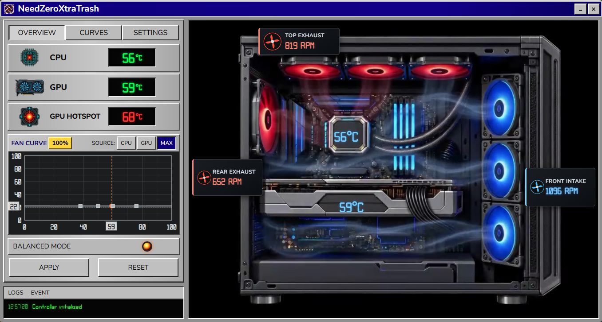

# NeedZeroXtraTrash

Приложение для Windows 10/11, управляющее тремя группами корпусных вентиляторов через NZXT RGB & Fan Controller / Smart Device V2. Доступны кривые по CPU/GPU, профили охлаждения, температуры, RPM, тест вентиляторов и аварийный режим. Контроллер продолжает работать после закрытия окна.

## Версия и запуск

`version.txt` указывает 4.7. [Исходный README](README_ORIGINAL.md) и [карта проекта](PROJECT_MAP.md) пока описывают 4.6; перед публичным тегом 4.7 нужно сверить их с фактической сборкой.

Для разработки: Python 3.12 x64 и зависимости из lock-файлов. Без оборудования можно проверить `python tests/test_core.py`. Сборка выполняется через `build.bat`; установленный контроллер NZXT нужен для аппаратной приёмки.

## Исходники и лицензия

Основной код — `src/needzero`. Проект распространяется по [GPL-3.0-or-later](LICENSE). Сторонние библиотеки из локальной папки `lib` в эту копию не включены; способ получения зависимостей описан в `fetch_deps.py`.

## История

Подтверждён текущий номер 4.7, но точный список изменений относительно 4.6 ещё требует сверки. Релизные заметки не выдуманы.
